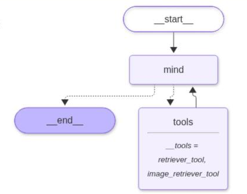
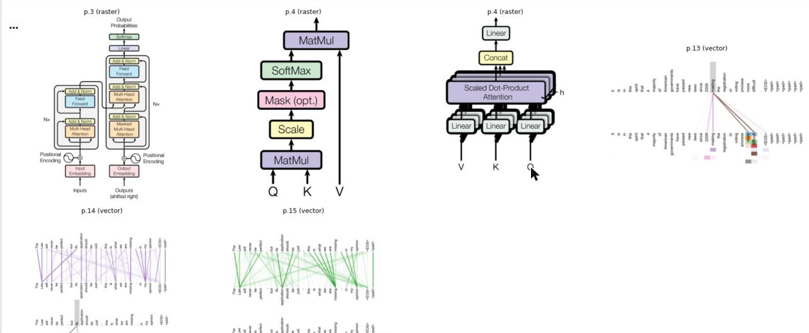
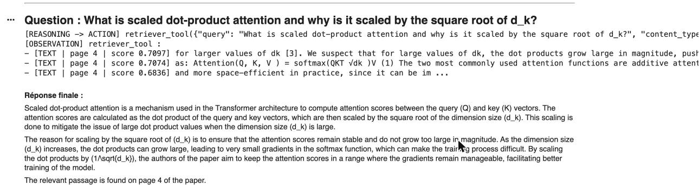
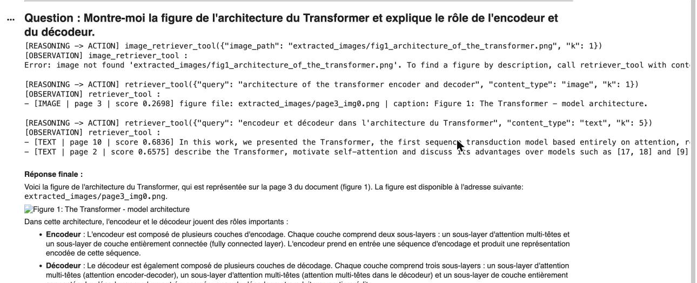
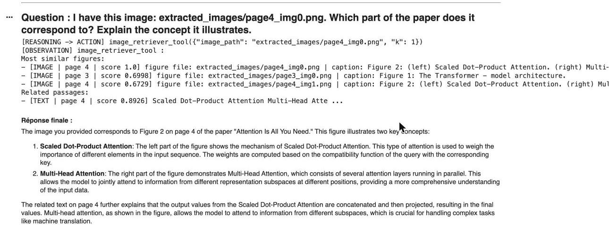

# RAG Multimodal Agentique — *Attention Is All You Need*

Application RAG (Retrieval-Augmented Generation) **multimodale** et **agentique** qui extrait, indexe et interroge
de façon autonome le texte **et** les figures de l'article *Attention Is All You Need* (Vaswani et al., 2017).

> Activité Pratique N°3 — IA Générative Multi Modale, Master 5 IIIA, HESTIM
> Réalisé par **Nada Mahrouz** — encadrant : Pr. Mohamed YOUSSFI

 
 


## Architecture

```
PDF ──► PyMuPDF ──► chunks de texte + figures (+ légendes)
                         │
                         ▼
                CLIP ViT-B-32 (espace latent commun texte/image, 512 dim.)
                         │
                         ▼
                ChromaDB (cosinus, id SHA-256, métadonnées)
                         │
                         ▼
        retriever_tool / image_retriever_tool  (BODY)
                         ▲   │
                         │   ▼
              Agent ReAct LangGraph — LLM Qwen 2.5 via Ollama (MIND)
```

| Étape | Contenu | Outils |
|---|---|---|
| 1 | Extraction du texte (chunks de 45 mots) et des figures raster + vectorielles | PyMuPDF |
| 2 | Embeddings normalisés dans un espace commun texte/image | open_clip (ViT-B-32, laion2b) |
| 3 | Indexation avec identifiant de document SHA-256 et métadonnées | ChromaDB |
| 4 | Recherche par similarité cosinus à partir d'un texte **ou** d'une image | CLIP + ChromaDB |
| 5 | Encapsulation du retriever en outils pour l'agent | LangChain `@tool` |
| 6 | Agent ReAct (Reasoning → Action → Observation) | LangGraph, Ollama |
| 7 | Tests et validation sur 5 requêtes multimodales | — |

<p align="center"></p>

## Résultats

- **15 pages**, **178 fragments** de texte, **6 figures** extraites (dont 3 figures vectorielles rasterisées), chacune avec sa légende.
- **184 vecteurs** indexés ; la réindexation d'un même PDF est détectée grâce au SHA-256.
- CLIP rapproche chaque figure de la bonne description (architecture, attention, heatmaps), la description témoin « a photo of a cat » obtenant toujours le score le plus faible.

| # | Requête | Comportement de l'agent |
|---|---|---|
| 1 | Scaled dot-product attention et facteur √d<sub>k</sub> | 1 recherche texte → réponse correcte (p. 4) |
| 2 | « Montre-moi la figure de l'architecture… » | Erreur sur un chemin inventé → **auto-correction** → Figure 1 (p. 3) |
| 3 | Scores BLEU EN-DE / EN-FR + coût d'entraînement | BLEU exacts (28.4 / 41.0), coût d'entraînement imprécis |
| 4 | Requête par image (Figure 2) | Figure retrouvée + passages liés via la légende |
| 5 | « Bonjour, qui es-tu ? » | Réponse directe, sans outil |



<details>
<summary>Traces d'exécution de l'agent</summary>

**Test 1 — question textuelle**


**Test 2 — auto-correction et récupération de la figure**


**Test 4 — requête par image**

</details>

### Points clés
- **Écart de modalité (modality gap)** : avec CLIP, les scores texte→texte (~0,7-0,85) écrasent les scores texte→image (~0,25-0,35). Le `retriever_tool` interroge donc chaque modalité séparément puis fusionne les résultats ; sinon aucune image n'est jamais renvoyée.
- **Chaînage image → légende → texte** : le LLM ne voit pas les pixels ; l'outil image renvoie la légende de la figure la plus proche et les passages qui l'expliquent, ce qui supprime les hallucinations sur le contenu des figures.

Le rapport complet est disponible dans [`docs/Rapport_AP3_RAG_Multimodal_Agentique.pdf`](docs/Rapport_AP3_RAG_Multimodal_Agentique.pdf).

## Exécution

**Google Colab (recommandé)** : ouvrir `rag_multimodal_agentique.ipynb`, choisir *Exécution → Modifier le type d'exécution → GPU T4*, puis *Tout exécuter*. Le notebook installe les dépendances, Ollama, télécharge le modèle (`qwen2.5:7b` sur GPU, `qwen2.5:3b` sur CPU) et l'article depuis arXiv.

**En local** :
```bash
pip install -r requirements.txt
# installer Ollama : https://ollama.com puis
ollama pull qwen2.5:7b
jupyter notebook rag_multimodal_agentique.ipynb
```

## Structure

```
.
├── rag_multimodal_agentique.ipynb   # application complète (étapes 1 à 7)
├── requirements.txt
├── docs/Rapport_AP3_RAG_Multimodal_Agentique.pdf
└── assets/                          # captures des résultats
```

## Limites et pistes
- L'encodeur texte de CLIP (77 tokens) est moins précis qu'un embedding textuel dédié → recherche hybride (CLIP + bge/e5 ou BM25) et re-ranking.
- Un LLM 7B ne décompose pas toujours une question multi-parties → LLM plus grand ou étape de planification.
- Lecture directe des figures avec un modèle vision (LLaVA, Qwen2.5-VL).
